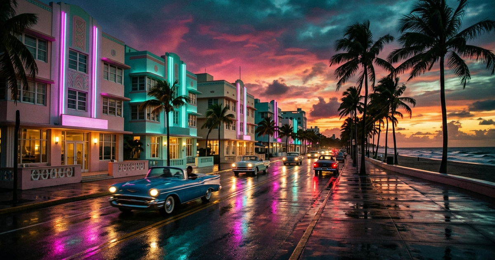
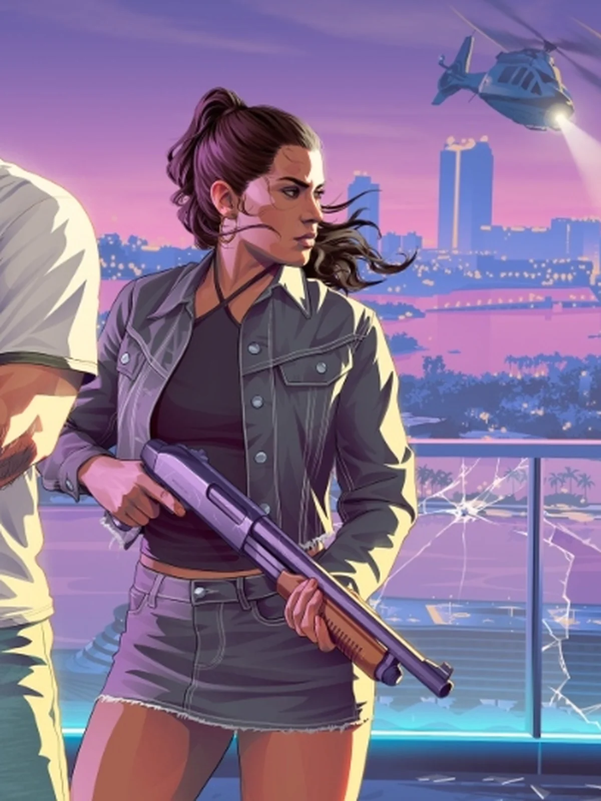
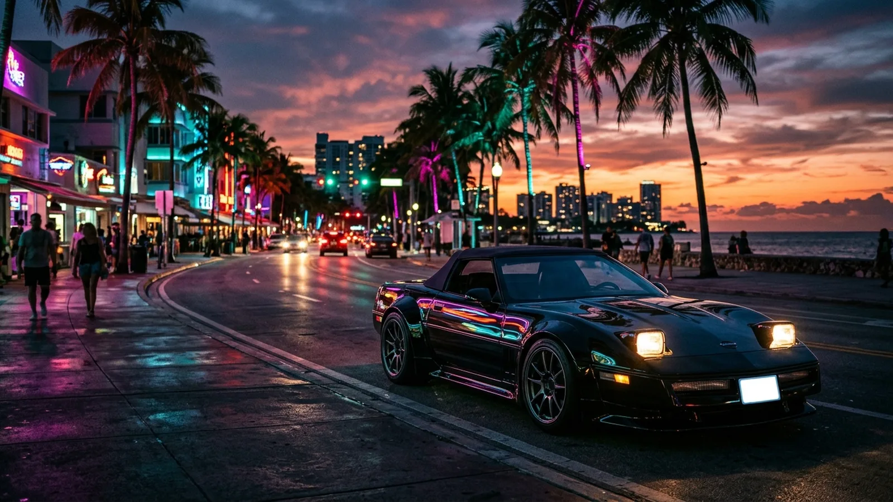
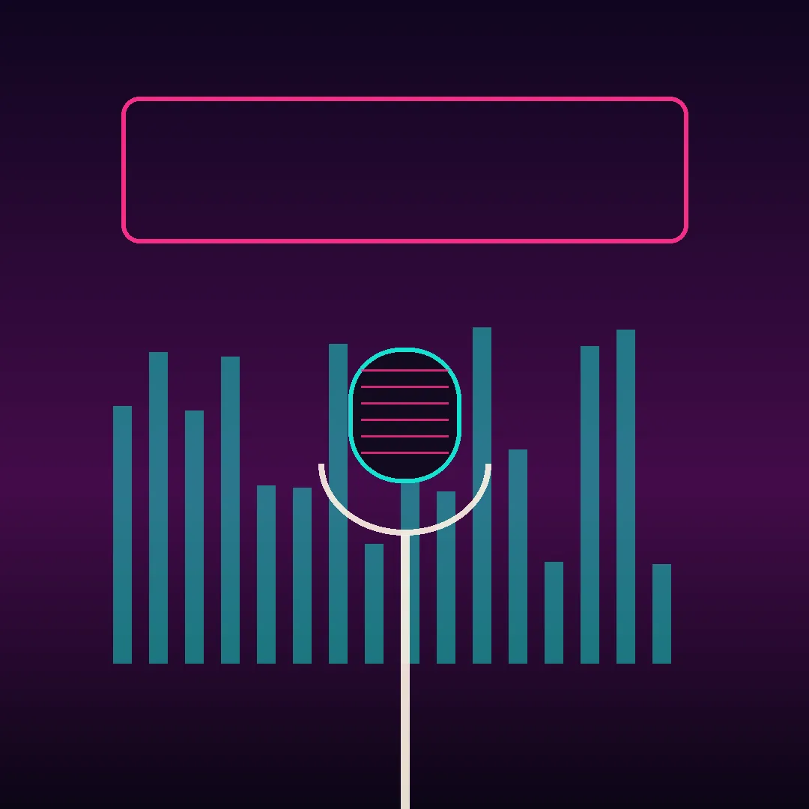
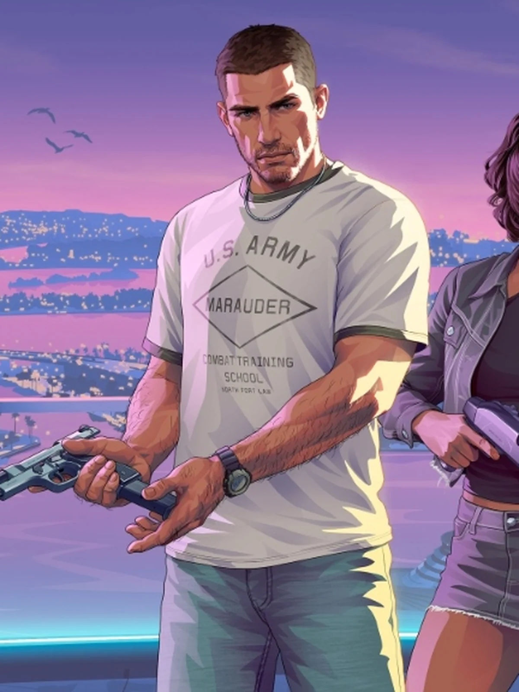
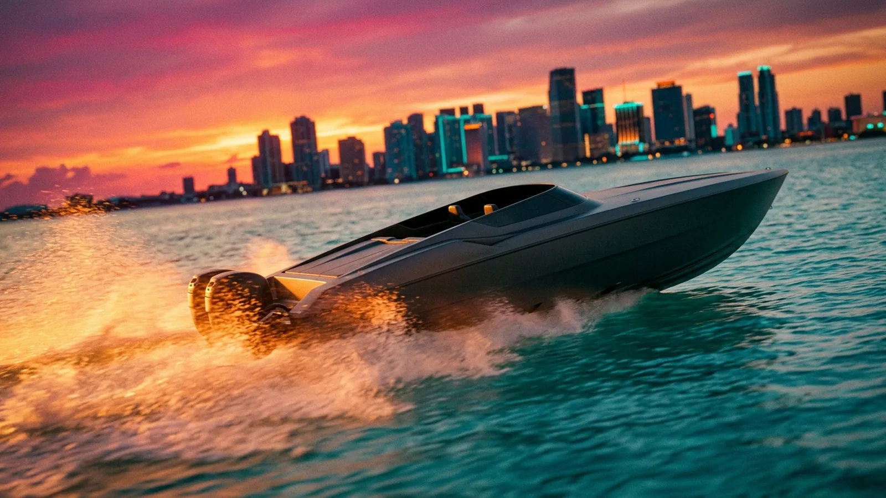
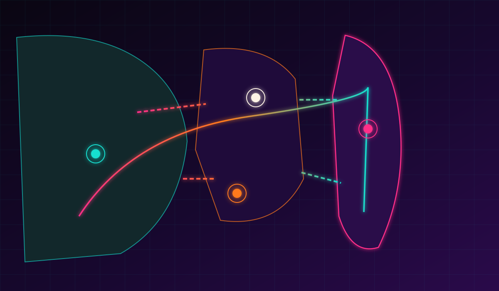

# Grand Theft Auto VI — Landing Page Conceitual de Fã (Pós-Lançamento)



> **Aviso Legal:** Este é um **projeto conceitual de fã**, estritamente **sem fins lucrativos** e **sem afiliação com a Rockstar Games ou Take-Two Interactive**. Todas as marcas pertencem aos seus respectivos titulares.

Landing page estática interativa e cinematográfica desenvolvida em **HTML5 + CSS3 + JavaScript (ES6+)** para a fase **pós-lançamento** de *Grand Theft Auto VI*, combinando animações de alto impacto, WebGL shader, síntese de áudio em tempo real (Web Audio API) e acessibilidade **WCAG 2.2 AA**.

---

## ✨ Visão Geral & Seções do Site

1. **Hero Cinematográfico em Camadas**
   - Abertura com loader neon e animação de *câmera descendo sobre a cidade* (`zoom + blur`) com revelação letra a letra do título.
   - Parallax multicamadas (`hero-sky.avif`, `hero-skyline.png`, `hero-palms.png`) controlado pelo **mouse**, pelo **scroll** e pelo **giroscópio** em dispositivos móveis.
   - Selo animado **DISPONÍVEL AGORA** com cálculo configurável de dias desde o lançamento, botões **Jogar agora** (PlayStation Store / Microsoft Store) e acesso direto ao **Trailer de Lançamento no YouTube**.

2. **Trailer & História Pós-Chegada**
   - Modal acessível com foco preso (`Tab` trap), fechamento via `Esc` e carregamento sob demanda do player oficial do YouTube (`youtube-nocookie.com`).
   - Narrativa pós-lançamento revelada palavra por palavra com **GSAP ScrollTrigger**.

3. **Guia do Jogador (Livre de Spoilers)**
   - Cards com dicas gerais de exploração, condução costeira, ambiente e fotografia, ilustrados com imagens responsivas (`vehicle-convertible.webp`, `vehicle-speedboat.webp`) e efeito *Ken Burns*.

4. **Vice City Imersiva (Scroll Pinned + Ciclo Dia/Noite)**
   - Navegação horizontal fixada (*pinned*) entre as regiões (**Ocean Strip**, **Everglades**, **Port Gellhorn**, **Downtown**).
   - HUD dinâmico com relógio e transição de atmosfera cromática do crepúsculo à alvorada, acompanhado de mapa vetorial estilizado (`assets/map-vice-city.svg`).

5. **Personagens (Tilt 3D + View Transitions)**
   - Perfis interativos de **Lucia** e **Jason** com efeito *tilt 3D* no card, barras de atributos animadas e transição suave por máscara + **View Transitions API**.

6. **Modo Foto da Comunidade (Filtros + Lightbox)**
   - Galeria responsiva com filtros CSS em tempo real (**Normal**, **Retrô 80s**, **Neon Noir**, **Noir P&B**).
   - Lightbox completo com **zoom**, navegação por **setas do teclado**, suporte a **gestos de swipe** no mobile e foco preso.

7. **Rádio Vice FM (Web Audio API · CC0)**
   - Sintetizador procedural 100% livre de direitos autorais (**CC0**) com 3 estações fictícias (*Wave 104.9 FM*, *Flamingo 98.3 FM*, *Vice Nocturne 88.1*) e **equalizador de frequências em tempo real** (`AnalyserNode` + `<canvas>`).
   - Inicia **mudo por padrão**, com botão claro de ligar/desligar som e opção de **SFX de interface** no cabeçalho.

8. **Novidades, Comunidade & FAQ**
   - Linha do tempo pós-lançamento (com itens de exemplo claramente marcados como placeholder), links de redes sociais, formulário de newsletter com validação nativa e consentimento **LGPD**, além de FAQ atualizado.

---

## 🖼️ Galeria de Assets do Projeto

| Personagens (Tilt 3D) | Veículos & Guia | Rádio & Mapa |
| :---: | :---: | :---: |
|  |  |  |
|  |  |  |

---

## 🛠️ Tecnologias, Performance e Acessibilidade

- **Animação & Scroll**: [GSAP 3.12.5](https://greensock.com/gsap/), `ScrollTrigger` e [Lenis 1.1.13](https://lenis.darkroom.engineering/) carregados **sob demanda** (`requestIdleCallback`), além de **CSS Scroll-Driven Animations** (`animation-timeline: view()`) e **View Transitions API**.
- **Fundo WebGL Leve**: Shader customizado em `<canvas>` único com gradiente de pôr do sol, ondas de calor e partículas de vaga-lume (pausado automaticamente quando a aba fica oculta).
- **Otimização de Imagens**: Formatos modernos **AVIF** e **WebP** com `srcset` (`480w`, `960w`, `1200w`, `1600w`, `2560w`), `loading="lazy"` (exceto LCP com `preload`) e placeholders *blur-up* em Base64 (`assets/placeholders.json`).
- **Acessibilidade (WCAG 2.2 AA)**: Navegação completa por teclado, foco visível, `aria-live`, foco preso em modais/lightbox, suporte integral a `prefers-reduced-motion` e cursor customizado restrito a dispositivos com mouse (`@media (hover: hover) and (pointer: fine)`).
- **Bilíngue (PT-BR / EN)**: Troca instantânea de idioma em `js/i18n.js` incluindo atributos `alt`.

---

## 🚀 Como Executar Localmente

O projeto é 100% estático e não exige etapa de build:

```bash
# Clone o repositório
git clone https://github.com/eltoncelestino/gta-VI.git
cd gta-VI

# Suba um servidor HTTP local
python -m http.server 8000
# ou via Node.js:
npx serve .
```

Acesse **`http://localhost:8000`** no navegador.

---

## 📁 Estrutura de Pastas

```text
gta-VI/
├── index.html                   # Estrutura semântica, SEO, Open Graph e JSON-LD (VideoGame)
├── manifest.webmanifest         # Manifesto PWA e ícones
├── robots.txt / sitemap.xml     # Indexação SEO
├── midia-gta6.csv               # Planilha de curadoria de mídia e direitos autorais
├── relatorio-midia-gta6.md      # Relatório completo de fontes e licenciamento
├── css/
│   └── style.css                # Design system neon-noir, animações e responsividade
├── js/
│   ├── config.js                # Data de lançamento, links das lojas, YouTube e flags
│   ├── i18n.js                  # Dicionário PT-BR / EN
│   └── main.js                  # Motion stack, WebGL, Web Audio API, Lightbox e LGPD
├── legal/
│   ├── privacy.html             # Modelo de Política de Privacidade (LGPD)
│   └── terms.html               # Modelo de Termos de Uso e atribuições
├── scripts/
│   ├── generate_assets.py       # Gerador procedural de imagens (Python/Pillow)
│   ├── import_ai_images.py      # Conversor de renders IA para AVIF/WebP + srcset
│   └── optimize.mjs             # Pipeline de otimização com sharp (Node.js)
└── assets/
    ├── PROMPTS.md               # Prompts de geração de imagem documentados
    ├── placeholders.json        # Placeholders blur-up em Base64
    ├── map-vice-city.svg        # Mapa vetorial estilizado conceitual
    └── *.avif / *.webp / *.png  # Assets otimizados com variantes responsivas
```

---

## ⚙️ Personalização

1. **`js/config.js`**: Ajuste `releaseDate`, links oficiais de `stores.ps5`, `stores.xbox`, `social.*`, `trailer.youtubeId` e flags de recursos (`webgl`, `uiSound`, `radioMuted`, `haptics`, `gyroParallax`).
2. **Pipeline de Imagens**: Caso substitua imagens em `assets/`, execute `node scripts/optimize.mjs` (requer `npm i -D sharp`) para gerar os novos `srcset` e `placeholders.json`.
3. **Publicação**: Substitua `SEU-DOMINIO.com` e `SEU-EMAIL@dominio.com` em `index.html`, `robots.txt`, `sitemap.xml` e `legal/`.

---

## 📄 Direitos Autorais e Créditos

- Os retratos promocionais dos personagens na seção **Personagens** são `© Rockstar Games / Take-Two Interactive`, utilizados exclusivamente em caráter de projeto conceitual de fã sem fins lucrativos (conforme a Política de Fan Site da Take-Two).
- As demais imagens de cenário, galeria, mapa vetorial e faixas de áudio sintetizadas (CC0) são originais/geradas por IA ou procedurais.
- Documentação detalhada de fontes e termos disponível em [`relatorio-midia-gta6.md`](relatorio-midia-gta6.md) e [`midia-gta6.csv`](midia-gta6.csv).
